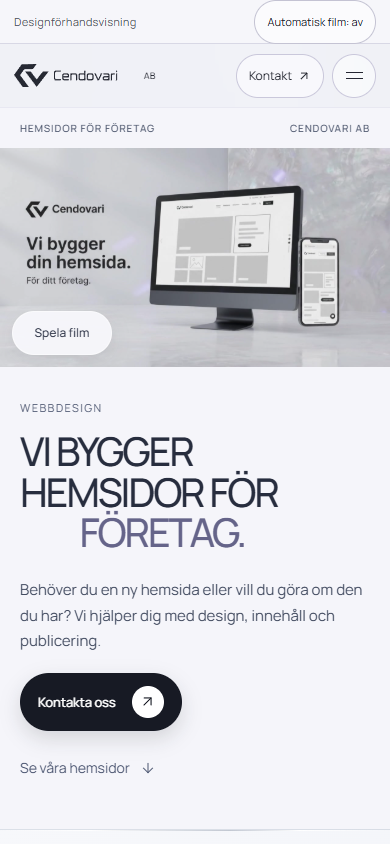
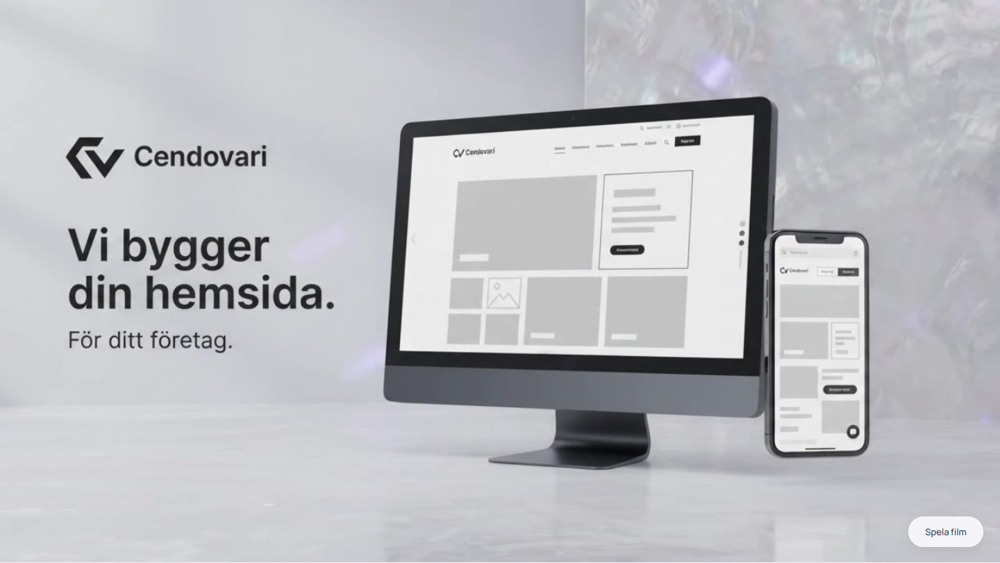

# Toppfilm och sidbyten — granskning 2026-10-13

## Vad som ändrats

Utgångspunkt är ren lokal/remote main `9fe6de943811da098d235db6d32e0c2b1d32d2ad`, verifierad origin och arbetsbranch `codex/film-navigation`. ZIP-SHA256: `5102492bb007c7c0c22b9118f68566693a4b59558853fe0c5428c1c4f58d0a0b`. Alla fem manifestposter matchar. Paketet innehåller ingen helsida; aktuell main och dess senare fixar är bevarade.

Endast toppfilmen och dess poster byttes, byteidentiskt med paketet. MP4-parser och full FFmpeg-avkodning verifierar H264, 1280×720, 24 fps, 240 bildrutor, 10,000 s, inga ljudspår och moov före mdat. Avkodningen slutförde alla 240 ramar utan fel/dup/drop. Postern är JPEG 1280×720 och matchar bäst filmens 5-sekundersbild. FFprobe och Gemini-originalfilen saknas lokalt; ingen ny originalspårs-/FFprobe-jämförelse påstås. Ingen omkodning eller AI-redigering gjordes.

Den stora Cendovari-mellanbilden och dess wipe-CSS togs bort. Inkommande sida visas nästa task med enbart opacity 0,94→1 på 140 ms, utan transform eller blank mellanvy. Timern avslutas efter sidbytet och samma animationslängd; äldre generationer avbryts. Reduced/motion-off byter utan animation. Pendingflagga, same-page-event, fokus, meny, sektionhopp och projektåtergång är bevarade; interna val laddar inte om dokumentet.

Headerns befintliga desktopsektionsrad är tillgänglig mellan alla huvudvyer och leder till rätt startsidessektion. Detta tar bort det tidigare höjdhoppet på 62 px utan att ändra mobilmenyn. På smal vy flyttades samma filmknapp till den fria nedre vänstra delen så att telefonbilden inte täcks. Filmbilden behåller full 16:9/contain och originalets pixlar.

Källan refererar direkt till nya hela toppfilmen, inte en gammal inlinefilm. Tre uttryckliga hashmappningar ändrades. Defaultbuild, legacy-CLI och upprepning ger byteidentisk export; gamla film-/posterbytes avvisas. Render/shell, headerlogga, GPPE, formulär, projekt- och filmcontrollers är bevarade.

## Lokal browsergranskning

Installerad Chrome på Windows med Playwright/DevTools: **320×844, 390×844, 768×1024, 1440×900, 844×390**, dessutom reducerad rörelse vid 390×844. Mobil/touch är emulering.

- 173/173 ytkontroller: Hemsidor/Portfolio/Om oss/Kontakt, upprepade/snabba/samma navval, kontaktknappar, mobilmeny/lås/fokus, projekten, Tillbaka/Escape, sektionhopp från andra vyer, GPPE-länkar, kontaktutkast/validering/kopieringsfallback, vanlig scroll och ingen horisontell overflow.
- Före-bild och tidsserie reproducerade gammalt stort wipe-lager och headerhöjdhopp. Fyra nya tidsserier verifierar faktisk 140 ms-animation, minsta opacity 0,94, ingen overlay, stabil headerbredd/höjd och exakt en synlig sida. Sentinel och performance-navigation visar ingen intern omladdning.
- Två tidiga timingfixture-assertioner var för stränga: ett 0 ms-jobb kan ännu visa gamla sidan före nästa task, och en godtycklig 50 ms-deadline är inte ett animationskontrakt. Råproven bevaras; verifierad animation är 140 ms och ingen gammal vy återkommer efter genomfört byte.
- 137/137 filmkontroller: nya toppfilmen spelades två hela loopar vid 390 och 1440. Separata decoded/total/rVFC/presented-räknare gav 1059, 0 rapporterade drops/stopp och 0 src/load/currentTime-/emptied-reset. Manuell/global paus, scroll ut/tillbaka, meny/sidbyte, reduced, nekad autoplay/Spela/poster och sena ägaranrop testades. Övriga klipp kontrollerades för oförändrade bytes och fungerande livscykel.
- 20/20 navkontrakt samt slutliga 28/28 statiska/build-kontroller. De gamla kompakt-/original-/posterbytesen avvisas.

Dessa fulla yta-/filmprover gäller v1. Slutversion v2 ändrar bara mobilknappens CSS-position. Att återställa den enda regeln återbildar både hela v1-källan och index byteexakt; alla controllers, mediefiler och övrig layout är identiska. Riktade v2-touch-, tangentbords-, bild-/kontroll- och overflowprov verifierar den nya placeringen. Resultat och eventuella kvalificerade extraprover redovisas i preview-review.json. Inga JS-, HTTP-, konsol-, requestfailed- eller backendfel observerades i de fulla lokala proven.

Slutsource SHA256: `3091138d1ec7f5773722fec1e5248951674e1b47ee2197d7ef181742d86c6566`.
Slutindex SHA256: `0526cb949d35f92fec4053b51d3d3171e024905ec7b9faabab1f0abf21a23fc4`.
Ny MP4: `9bf277fb246fa44e8685773f04129dfb393d491e47da696d506377a885f2d27b`.
Ny poster: `0dbd5567d79bfc4beb36ef5c2bc72f26f9f4d40660007970efa7d04e32e9cedb`.

## Publicering

Publicerad och verifierad på [GitHub Pages](https://cendovari.github.io/cendovari-webdesign-sida/) 2026-10-13. [Innehållscommit 13a4fc6](https://github.com/Cendovari/cendovari-webdesign-sida/commit/13a4fc629bce1f6cca0c4e2f646ff82dd3ef7a93) är en vanlig child-commit från verifierad main. [Pages-bygge 38352042040](https://github.com/Cendovari/cendovari-webdesign-sida/actions/runs/38352042040) slutförde build/deploy med success för samma commit. Arbetsbranchen och main uppdaterades utan force.

HTTPS 200 och exakta bytes verifierades för 23 filer, inklusive källa/export, nya filmen/postern, oförändrade GPPE-/exempelresurser, exportscript, dokumentation och skärmbilder. Alla tre MP4 gav även korrekt Range 206. Standardadressen utan query verifierades separat till samma indexhash.

Ny faktisk browser-QA av slutversion v2 på HTTPS provade alla sex vyer. Funktionella flöden passerar; fyra sidbytesserier visar 140 ms/opacitet 0,94→1, inget övergångslager, stabil header och ingen intern omladdning. De sex riktade offentliga mobilknappkontrollerna passerar. Rå yta-QA är **170/173**: tre strikta nätassertioner registrerade sex Bilverkstad-ERR_ABORTED vid snabba sektionshopp (320:1, 390:2, liggande:3). Varje event matchar CDP Media/canceled:true/URL/steg. Separat faktisk återspelning på 320 har rätt original/1280×720, pausar vid Escape och återupptar .527→1.262 s utan reset. HTTP 200, full filhash och Range 206 verifierades. Inga övriga JS-, konsol-, HTTP-, icke-canceled CDP- eller backendfel; avbrotten redovisas utan noll-requestfailed-påstående.

Den nya toppfilmen genomgick **137/137** faktiska offentliga filmkontroller i fyra lägen. Två hela loopar vardera vid 390 och 1440: 1061 decoded/totalramar, 1062 rVFC-callback/presented-räknare, 0 rapporterade drops/stopp och 0 src/load/currentTime-/emptied-reset. Räknarna är separata sampel. Alla nya film-/posterhashar matchar i varje läge; paus, navigation, rörelselägen, nekad autoplay och sena ägaranrop passerar. I dessa filmprov observerades 0 JS-/HTTP-/requestfailed-/CDP-canceled-/backendfel.

Ett efterföljande dokumentationskvitto ändrar endast README, denna rapport och preview-review.json. Den testade källan, exporten, filmen och postern är oförändrade. Befintligt Pages-flöde och standardadress används; inga publicerings-, domän- eller DNS-inställningar ändras.

## Skärmbilder

Sidbyte: [före med wipe](screenshots/film-navigation-before-contact.png), [efter utan mellanbild](screenshots/film-navigation-after-contact.png). [Kort liggande mobilmeny](screenshots/film-navigation-landscape-menu.png).

Mobilbilden visar slutversion v2. Desktop-/kontakt-/landskapsbildernas komposition är oförändrad från v1; endast mobilknappens CSS skiljer. Posterbilderna är märkta statiska/reduced med currentTime 0 och ingen seek; de illustrerar inte en påstådd uppspelningssekvens. Inga testkontaktuppgifter finns i bilderna.

## Begränsningar och omfattning

Fysisk Safari/iPhone eller Chrome/Android, verkligt adressfält/skärmtangentbord och verkligt dold flik är inte testade. Hidden-state använder uttrycklig document.hidden/visibilitychange-simulering; autoplay-nekande injicerar NotAllowedError följt av ett faktiskt browserklick. Ikoner och typsnitt behöver befintliga externa leverantörer. Avkodningsräknare är browsermätningar, inte en garanti för perfekt fysisk skärmvisning.

Endast Cendovari/cendovari-webdesign-sida ändras. Produktion, Cendovari-Website, Modbus Buddy, WordPress, cendovari.com, gppe.se, produktionshosting och DNS är orörda. Ingen ny backend eller riktig formulär-/mejlsändning. Svenska, noindex,nofollow och vanlig dokumentscroll är bevarade.

Historiken bevaras utan reset/force-push. Återställ vid behov med vanliga revert-commits i omvänd ordning: senare dokumentationskvitto först, därefter innehållscommit.
