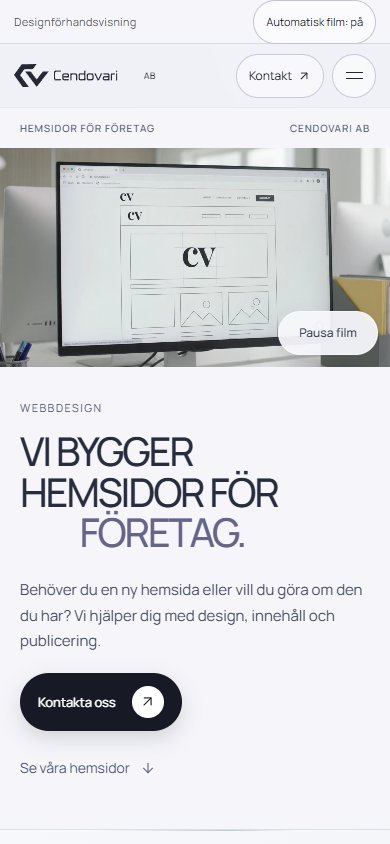
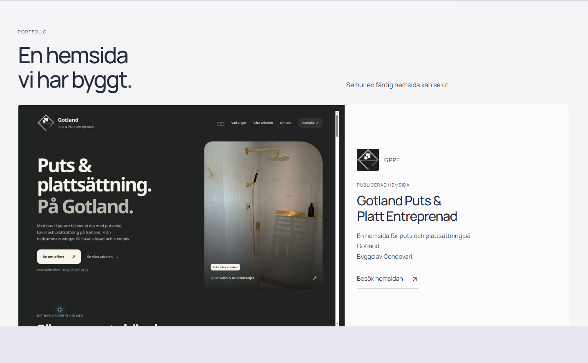

# GPPE-versionen — granskning 2026-10-11

## Ändringen

Utgångspunkt är ren lokal/remote main `3c3ebb16f8ee0ddbd4aaea754dddc554acb1d88a`, verifierad origin och separat branch `codex/gppe-portfolio`. Paketet `cendovari-gppe-handoff.zip` har SHA256 `58cdd816671e73c33e59cb00ee1974551059da33d0cb72f2a7647ec841c1f27c`; alla 16 manifestposter matchar.

Godkänt innehåll och komposition är bevarade: stor huvudfilm, ”Vi bygger hemsidor för företag.”, kortare texter, datorskärm/telefon i tjänsterna och GPPE med riktig skärmbild/logga. Home-portfolion ligger efter processen. Gotland Puts & Platt Entreprenad krediteras ”Byggd av Cendovari.” Tre vanliga externa länkar går till https://gppe.se/ och öppnar aldrig ett koncept. Bilverkstad och det separata äldre Plattsättning-exemplet på Portfolio är märkta designförslag; det senare representerar inte GPPE.

Källan avviker från paketet med **en enda 24-bytesrad**: `menu.scrollTop = 0;` när mobilmenyn öppnas. Ett verkligt browserprov visade att gammal intern menyskroll annars kunde lägga första fokuserade knappen ovanför menypanelen vid återöppning i kort liggande vy. Rättelsen ger synligt fokus utan visuell redesign, scrollhopp eller ändrade filmcontrollers.

Exporten använder main-versionens dokumentram/CSP och paketets innehåll. Två CLI-kommandon och upprepad byggning ger byteidentisk export. Sex bilder externaliseras relativt; tre kompakta källklipp ersätts i exporten med fulla originalfiler. Source SHA256: `965a082180304d9b1951d91b4167eba1265097381b582c31a14244ea207f9a21`. Index SHA256: `e1b495018cda03cb147c6b5c7ca1744d286e9cbad6f275fc480d2e9760c0ab28`.

## Genomförda lokala kontroller

Installerad Chrome på Windows, med Playwright/DevTools, vid **320×844, 390×844, 768×1024, 1440×900 och 844×390**, dessutom reducerad rörelse vid 390×844. Mobil och touch är emulerade, inte fysiska telefoner.

- Startsida, Portfolio, Om oss och Kontakt: text, bildproportioner, logga, ikoner, typsnitt, kompletta sektioner och ingen horisontell overflow. Hero-geometrin matchar paketets export på 390/1440.
- Mus-/PageDown-/tangentbord-/touchscroll, sektionshopp, mobilmeny vid flera scrollpositioner, fokusfälla/Escape, bakgrundslås, stängning/återgång och rotation.
- GPPE:s tre externa länkar öppnades faktiskt; konceptpanelen förblev stängd. Båda separata designförslagen provades med Dator/Mobil, interna länkar, Tillbaka/Escape och fokusåtergång.
- Process, FAQ, designstil/jämförelse och inspiration till Kontakt. Lokal validering, utkast, redigering och manuell kopieringsfallback; inga backend-/utskicksanrop.
- 49 export-/säkerhets-/assetkontroller samt 33 avslutande determinism-/integrationskontroller. Alla passerar.
- Fullmatrisen gav 148/154 råa pass. Sex textkontroller använde textContent utan mellanrum över ett br-element; faktisk innerText och separat bild-/logg-/länkprobe kvalificerade samtliga sex. Ingen kodändring behövdes för detta testfel. Menyfokusfyndet ovan rättades och provades separat på slutexporten.

Alla tre refererade originalfilmer är byteidentiska med paketet och tidigare fullängdsoriginal: H.264, 1280×720, 24 fps, 240 ramar, 10,000 sekunder, utan ljud. **Åtta faktiska tvåvarvsprov** omfattar huvudfilm, Bilverkstad på startsidan och båda konceptfilmerna vid 390 och 1440. Avkodnings-/totalramräknarna gav 4255 ramar, 0 rapporterade tappade ramar och 0 stopp/reset. Scroll/paus ändrade inte src, load eller currentTime. Detta är webbläsarmätning, inte ett påstående om perfekt fysisk skärmvisning.

Filmkontrollerna provades med manuell/global paus, scroll ut/tillbaka, meny, reducerad rörelse, nekad autoplay med fungerande poster/Spela och sena uppspelningsanrop efter navigation. Kvalificerat resultat är 117/117; originalkörningen 116/117 bevaras som historik: två posterrequest fick tillfälligt lokal connection refused. Separata HTTP 200 och riktat denied-autoplay-omprov 9/9 passerade utan appändring. Inga kvarvarande JS-/konsol-/HTTP-/backendfel observerades.

## Publicering

Kontrollen på den verkliga Pages-adressen återstår i denna innehållscommit. Ett efterföljande dokumentationskvitto redovisar lyckat bygge, HTTPS-/hashkontroller och faktisk publicerad webbläsargranskning. Samma main/rot-flöde och standardadress används; inga Pages-/domäninställningar ändras.

## Skärmbilder

Skärmbilderna är tagna i browser på den godkända kompositionen före den osynliga menyfokusrättelsen; inga inmatade testuppgifter ingår.

Fler bilder: [desktop film](screenshots/gppe-desktop-start.png), [desktop starttext](screenshots/gppe-desktop-headline.png), [skärm och telefon](screenshots/gppe-mobile-services.png), [mobil GPPE](screenshots/gppe-mobile-portfolio.png), [GPPE bland exemplen](screenshots/gppe-desktop-featured.png).

## Begränsningar och återställning

Fysisk Safari/iPhone och Chrome/Android är inte testade. Faktiskt dolt dokument kunde inte framkallas i den ägda Chrome-miljön; visibilitychange/dold-status och autoplay-nekande testades därför med tydlig simulering/injektion. Det ersätter inte riktiga bakgrunds-/enhetstester. Ikoner/typsnitt kräver befintliga externa leverantörer. Paketets två blankrader med whitespace har bevarats byteexakt; diff-check visar fyra kosmetiska source/export-varningar.

Historiken bevaras utan hard reset/force-push. Återställ vid behov med vanliga revert-commits, senare dokumentationskvitto först och därefter innehållscommit.

Endast det separata webbdesignprojektet ändras. Produktion, Cendovari-Website, Modbus Buddy, WordPress, cendovari.com, gppe.se, hosting och DNS är orörda. Ett läsanrop till gppe.se verifierade den befintliga sidan; inga skrivningar gjordes där. Kontakt förblir lokalt demo och noindex,nofollow bevaras.
