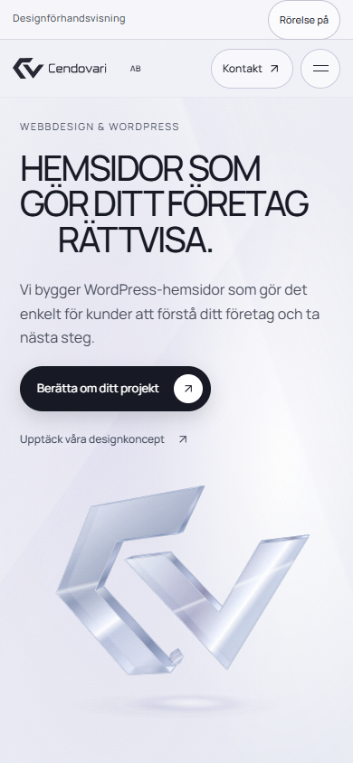
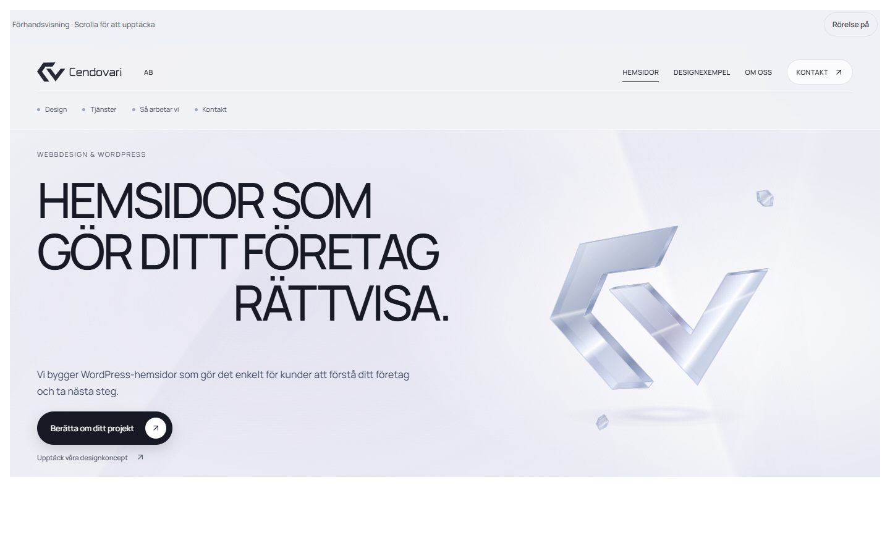

# Mobilförfining — underlag för granskning

Datum: 2026-10-10. Arbetsbranch: `codex/luminous-mobile-refinement`.

Den här versionen utgår från aktuell publicerad main, `6ecb3e31ad15d4636d1d607af17555788aae5a3a`. En ren, separat klon användes. Ingen äldre ZIP-källa återimporterades. Den tidigare publicerade iframe-rättelsen för kontaktutkastet är bevarad.

**Main och GitHub Pages visar fortfarande den tidigare versionen. Arbetsbranchen ska granskas och godkännas innan den förs till main.**

## Prova resultatet

[Hämta arbetsbranchens ZIP](https://github.com/Cendovari/cendovari-webdesign-sida/archive/refs/heads/codex/luminous-mobile-refinement.zip), packa upp och öppna `index.html`. Exporten fungerar fristående. Internet behövs för ikoner och typsnitt. Alternativt kör lokal HTTP-server enligt [README](../README.md).

Prova särskilt mobilmenyn, långsam och snabb scroll i båda riktningarna, rörelseknappen, båda koncepten från startsidan och Designexempel, Dator/Mobil-val, jämförelsen samt inspiration → kontaktutkast → ändra/kopiera.

## Prioriteringar från genomgången

Baslinjen granskades i 32 tillstånd vid fyra storlekar: startsida, alla sektioner, Designexempel, båda koncepten, Om oss och Kontakt. Följande verkliga problem styrde arbetet:

| Problem före ändringen | Åtgärd |
| --- | --- |
| Vid 320 px tog previewbaren 88 px och startsidans header 204 px. Kontakt hamnade på egen rad. | Previewbar 44 px, header 64 px, direkt kontaktväg och separat mobilmeny. |
| Vid 390 px tog previewbaren 61 px och headern 148 px. Kristallen låg över läsytan. | Text, tidig projektknapp och kristall får egna ytor och anpassade proportioner. |
| Fast 700 px scrollbehållare gav två scrollflöden på korta skärmar och yttre overflow vid 1024×768. | Exportshell, iframe och inner scroller följer tillgänglig höjd. Bara inner scroller används. |
| Lång mobilstory, beskurna konceptnamn och bildtext över telefonen efter paus/återstart. | Kortare mobilsekvens, två hela glaskort och korrekt återställning av separata dator-/telefonaktörer. |
| Små kontroller och jämförelsedrag som kunde konkurrera med vertikal scroll. | Touchytor minst 44 px i kontrollerade touchlägen och dragning som väljer riktning först. |
| Datorillustrationen kunde gå över bildtexten och beskäras vid 1024 px. | Storlek och placering begränsas av den tillgängliga scenhöjden ovanför bildtexten. |

## Vad som förbättrats

- Mobilmenyn har riktiga knappar, tillgängliga namn, `aria-expanded`/`aria-controls`, dialogsemantik, fokusfälla och Escape. Bakgrundsinnehållet blir inert. Menyn stängs före navigation och mätning av scrollmål. Scrollåsningen släpps vid stängning, sidbyte och byte till desktop.
- Adressfälts-/tangentbordshöjd ändrar den synliga scrollbehållaren utan att räkna om storyns längd. Breddbyte/rotation kan komponera om scenen med bevarad logisk position. Korta skärmar använder vanligt sidflöde. Safe-area-insets hanteras i exportshell och viktiga kontroller.
- Mobilens huvudrubrik, budskap, projektknapp och kristall har egen placering. Sektionernas läsordning, textstorlek, luft, illustrationer och sidfot är anpassade. Vid 1024 px har rubriken och textbredden justerats; vid 1440 px behålls kompositionen.
- Mobilstoryns scrollsträcka är kortare. Konceptnamnen visas i två hela glaskort i stället för en beskuren karusell. Mobilen har fortsatt begränsade musreflektioner och inga flygande projektbilder.
- Datorillustrationen behåller sitt perspektiv och sin horisontella placering men ryms ovanför bildtexten. Aktörernas höjd cachas tills dimensionerna ändras. Telefonen behåller sin avsiktliga sidoplacering på breda skärmar.
- Konceptvyerna har nåbar Tillbaka-knapp, tydligt valt Dator/Mobil-läge och läsbara responsiva koncept. Upprepade öppningar/stängningar återställer scroll och synlig öppningsknapps fokus. Sena animationer och mediaanrop kontrollerar fortfarande ägarskap och synlighet.
- Jämförelsehandtaget väntar på avsiktlig horisontell dragning. Vertikalt svep scrollar sidan. Handtag, vanligt reglage och tangentbord styr samma värde, inklusive 0/100 och avbruten dragning.
- Kontaktfält använder 16 px text, e-posttyp, autofyllning och lämpligt mobilt tangentbord. Fel visas lokalt och fokuserade fält hålls åtkomliga. Projektval, inspiration och ifyllda uppgifter bevaras. Manuell kopiering ger instruktioner för touch respektive tangentbord.
- Mobilen spelar högst en dekorativ film åt gången med hysteresis vid synlighetsgränser. Dolda filmer stannar. Nekad uppspelning behåller postern och försöks inte igen vid varje scroll. Canvas stannar när dess scen inte syns. DPR-/bildfrekvensskydden finns kvar.
- Rörelseknappen och systemets reducerade rörelse stoppar relevanta CSS-animationer, canvas, filmer och animerad scroll. Det statiska läget visar samma innehåll och har alla funktioner kvar.

## Verifiering

Den breda funktionsmatrisen kördes i nio isolerade Chrome-profiler på den frysta exporten `fd79a22c…`. Den omfattade 258 kontrollgrupper och 218 layoutobservationer. Matrisen hittade de konkreta fel som beskrivs nedan; dess resultat ska inte läsas som att alla layoutassertioner i mellanversionen passerade. Därefter verifierades rättelserna riktat, med slutexporten `2e9cdf0e…`: faktisk previewbarhöjd efter rotation, touchytor även vid 1024 px, läsbar desktopbar, rätt synligt scrollankare vid paus/återstart, scenens bildtext och snabbt sektionsval i reducerat rörelseläge. Slutmatrisens tio testlägen passerade samtliga riktade kontroller, utan stegfel, JavaScript-undantag, HTTP-fel eller misslyckade requests.

| Emulerad vy | Omfattning |
| --- | --- |
| 320×844, 360×844, 390×844, 430×932 | Hela funktionsflödet, touch, mobilmeny och slutlig layout-/höjdkontroll. |
| 768×1024 | Hela funktionsflödet, meny/fokus och riktad kontroll av paus/återstart i Tjänster och övriga vyer. |
| 1024×768 | Hela funktionsflödet med touch; separat ramhöjdskontroll med både fin och grov pekare. |
| 1440×900 | Hela funktionsflödet med mus/tangentbord och visuell jämförelse mot baslinjen. |
| 844×390 | Kort liggande touchvy, navigation, koncept, kontakt och rotation tillbaka. |
| 320×568 | Extra kort stående vy: normalt sidflöde, scenlayout, meny, navigation och kontaktfält. |
| 390×844 med reducerad rörelse | Statiskt läge från laddning samt samtliga huvudvyer, koncept, kontakt och funktioner. |

Kontrollerade funktioner:

- Startsida, Designexempel, Om oss, Kontakt och samtliga startsidessektioner. Menyns öppna/stängda tillstånd, ARIA, Tab/Shift+Tab, Escape, scrim, fokus och släppt scrollåsning efter navigation/rotation.
- PB-system och Hagströms Motor från startsidan och Designexempel, Dator/Mobil-val, interna konceptlänkar, inspirationsknappar, Tillbaka/Escape och upprepade snabba öppningar/stängningar med återställd scroll/fokus.
- Stilval, jämförelsens vanliga reglage och tangentbord, 0/100, horisontell touchdragning, vertikalt svep och avbruten dragning. Processsteg och FAQ öppnades och stängdes.
- Kontakt från navigation, tjänsteval och inspiration. Validering, Enter i enkla fält, textarea-radbrytning, lokal sammanfattning, ändring av utkast, borttagning av inspiration och markerad manuell kopiering. Inga backend- eller formulärrequests.
- Verklig filmuppspelning i desktop-Chrome, matchande posters, paus, nekad uppspelning och begränsningen till en mobilfilm. Canvas-/rörelsestopp vid paus, systembyte och simulerad dold sida. Alla ikoner blev SVG; inga kvarvarande ikonplaceholders eller misslyckade resurser.
- Snabb/långsam scroll och återgång, navigation under pågående övergång, fokuserade fält vid emulerad tangentbordshöjd och stående–liggande–stående. Ingen oavsiktlig horisontell eller yttre vertikal scroll i de kontrollerade slutlägena.

Höjd 844→744→844 vid 320/390 px bevarar exakt scrollTop och storyprogress i dator-, telefon- och konceptfasen. Aktörernas layout följer den synliga höjden så bildtext och kontroller ryms. Tjänster nedanför storyn behåller också sin placering. Vid 1024×768 mäts previewbaren till 56 px med fin pekare och 61 px med grov pekare; scroller blir 680 respektive 675 px i samma 736 px iframe.

Ett sluttest vid 768 px hittade ett felaktigt scrollankare: en osynlig/inert hero kunde väljas vid paus i Tjänster. Ankaret begränsas nu till synliga, direkta innehållssektioner. Oberoende omtest gav mindre än 0,5 px avrundning i Tjänster och exakt oförändrad position i Om oss, galleriet, båda öppnade koncept och Kontakt.

Scenernas slutkontroll jämför aktörerna med själva textens tvådimensionella område. Telefonen på desktop ligger avsiktligt vid sidan om bildtexten och ska inte bedömas som överlapp bara för att den når samma y-position. Datorillustrationen ryms ovanför texten och scenens nederkant. Ett samtidigt Kontakt→Tjänster-val utan animation avbryter det tidigare sidbytet och visar det senaste sektionsvalet.

19 källscripts och runtime-scripts har giltig syntax. Exporten regenereras byteexakt. De tio inbäddade medieposterna är oförändrade. Fristående `file://`-export testades med ikoner, typsnitt, navigation och lokalt kontaktutkast. Inga JavaScript-undantag eller misslyckade requests hittades; det kända Clipboard-policyfelet hanteras med den testade manuella fallbacken.

Kontrollerna använder isolerade Chrome-profiler på Windows. Viewport, touch, rotation och minskad höjd emuleras på desktop. De är inte tester på fysiska telefoner. Safaris iPhone-specifika beteenden, Androids verkliga tangentbord/adressfält, notch/safe areas och mobilens batteri/GPU har inte verifierats på riktiga enheter. Bakgrundsläget testas med simulerad `document.hidden`; faktisk OS-/flikväxling är inte verifierad.

## Mätning och desktopjämförelse

Instrumenterade Chrome-körningar jämförde baslinje och kandidat vid 1440×900 och 390×844. Mätfönster var cirka 2,2 sekunder. Detta är en jämförelse i samma desktopmiljö, inte ett mått på fysisk mobilprestanda.

| Kontroll | Före | Efter |
| --- | --- | --- |
| Canvas i Om oss utanför bild | cirka 25 målningar/s | 0 |
| Samtidiga synliga dekorativa mobilfilmer | 2 | 1 |
| Samtidiga desktopfilmer | 2 | 2 |
| `getBoundingClientRect`-läsningar vid exakt 26 behandlade scrollhändelser, desktop | 546 | 520 |
| `getBoundingClientRect`-läsningar vid exakt 26 behandlade scrollhändelser, mobil | 442 | 416 |
| Canvas, filmer och rAF vid paus/simulerad dold sida | 0 | 0 |

Den första mätningen med fasta scrollskrivningar gav högre sammanlagda callback-/layouttal i kandidaten. Uppföljningen visade att kandidaten behandlade fler av samma scrollskrivningar; med lika många behandlade händelser minskade läsningarna från 21 till 20 per händelse på desktop och 17 till 16 på mobil. Inga nya tunga ljus-/blur-animationer lades till. Mobilens glaskort har fått enklare rendering.

Slutlayouten kontrollerades igen: 1024×768 har ingen yttre overflow med fin eller grov pekare. Tre upprepade rotationer 844×390 ↔ 1024×768 och kort desktop → 1440×900 återställer rätt höjd. Mobilen har högst en spelande film; paus och canvas utanför vyn ger 0 rAF-anrop under mätfönstret. Previewbarens höjd läses bara när dimensionscachen behöver uppdateras, inte vid varje scroll.

Frysta 1440×900-bilder med reducerad rörelse från laddning jämfördes mot den godkända baslinjen. En tidigare slutkandidat (`367c675d…`) gav en pixelidentisk 1408×700 px innehållsyta: 0 ändrade pixlar, raw-RGBA-SHA256 `7370614606002eb446f2f13f6c667f3eef14e00355b96e9dc44e498523deccfb`. Den senare kandidaten `336ca23f…` hade samma geometri och visuella komposition men gav 3 respektive 307 avvikande innehållspixlar i två omkörningar, högst 0,031 procent av ytan och högst 1/255 per färgkanal. Den ska därför inte beskrivas som exakt pixelidentisk. Orsaken till variationen är inte fastställd. Slutversionens `2e9cdf0e…` desktopvy och scener granskades visuellt på nytt; datorillustrationens höjdanpassning är en avsiktlig ändring.

Desktopens 56 px previewbar har avsiktligt fått ljus bakgrund och bättre textkontrast. Den står för 78 846 ändrade pixlar. Normal desktop med rörelse jämfördes också visuellt i funktionskontrollen.

## Skärmbilder

Bilderna efter ändringen är tagna från slutexporten `2e9cdf0e…` i desktop-Chrome med angiven viewport. Före-bilderna kommer från den publicerade baslinjen. Rörliga scener kan vara fångade i olika animationstillstånd.

| Vy | Före | Efter |
| --- | --- | --- |
| Telefon 390×844 | [Före](review/before-mobile-390.png) | [Efter](review/after-mobile-390.png) |
| Telefon 320×844 | [Före](review/before-mobile-320.png) | [Efter](review/after-mobile-320.png) |
| Desktop 1440×900 | [Före](review/before-desktop-1440.png) | [Efter](review/after-desktop-1440.png) |

- [Öppen mobilmeny, 320 px](review/menu-320.png) och [kort liggande vy, 844×390](review/landscape-844.png).
- [Datorscen, 1024 px](review/desktop-scene-1024.png), [datorscen, 1440 px](review/desktop-scene-1440.png) och [telefonscen, 390 px](review/phone-scene-390.png).
- [Konceptkort](review/concept-cards-390.png), [designstudio](review/studio-390.png), [PB-system](review/pb-concept-390.png) och [Hagströms Motor](review/motor-concept-390.png), samtliga 390 px.
- [Om oss](review/about-390.png) och [lokalt kontaktutkast](review/contact-draft-390.png), 390 px. Testutkastets generiska provuppgifter skickas inte till någon backend.

## Bevarat material och begränsningar

- Två MP4-payloads och åtta inbäddade bildförekomster är byteidentiska med den publicerade källan. Filmerna är fortsatt korta illustrationsloopar; inga längre original fanns att klippa om. De är inte verifierat sömlösa.
- PB-system, Hagströms Motor och illustrationsmaterial är fortsatt tydligt märkta som designkoncept. Inga nya kunder, omdömen, priser, personuppgifter eller produktpåståenden har lagts till.
- Kontaktutkastet har ingen backend och skickar ingen e-post. Clipboard API kan ge ett policyrelaterat konsolmeddelande i iframe. Manuell kopieringsfallback är avsiktlig och testas separat.
- Exporten kräver JavaScript för att bygga sin sandboxade iframe. Med JavaScript avstängt blir sidan tom; någon no-JavaScript-fallback finns ännu inte. Detta är en kvarvarande begränsning, inte ett godkänt funktionstest.
- Källan och exporten har svenska, `cv-lumen`, lokal runtime och `noindex,nofollow`. Ikoner/typsnitt använder samma externa CDN-beroenden som baslinjen.
- Det här arbetet skriver bara i den nya isolerade klonen och arbetsbranchen i `Cendovari/cendovari-webdesign-sida`. Cendovari-Website, Modbus Buddy, WordPress, cendovari.com, hosting, domän/DNS och Pages-inställningar är orörda. Ingen force-push används.

## Exportens identitet

- Källans SHA256: `3f92bd30a63cb429ec6a03fce1c2384cbc9e128997093c6ab5848329894ba632`.
- Exportens SHA256: `2e9cdf0e6e17685909514e467ccc2b550a76b3dbc1cf16d0b324810c2f9af9a0`.
- Publicerad baslinje, oförändrad export: `a3b824e00f65f62e2112d0f9002827a3bfe7a5197cef3b63da5edc1ea20dff6e`.

