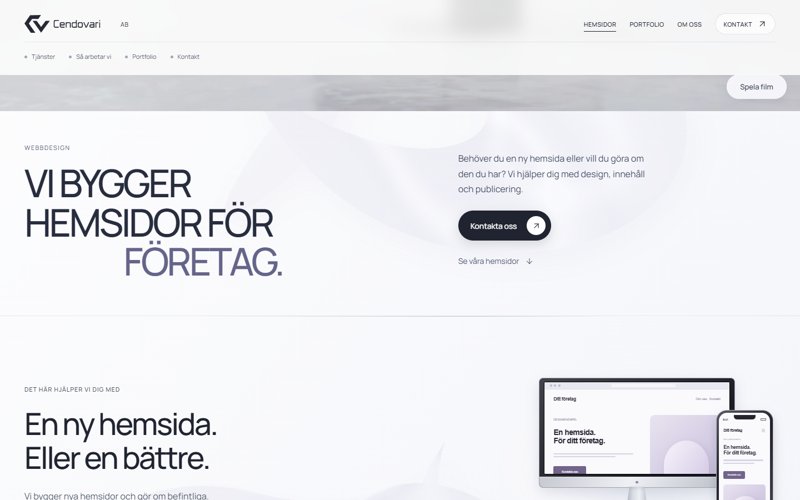
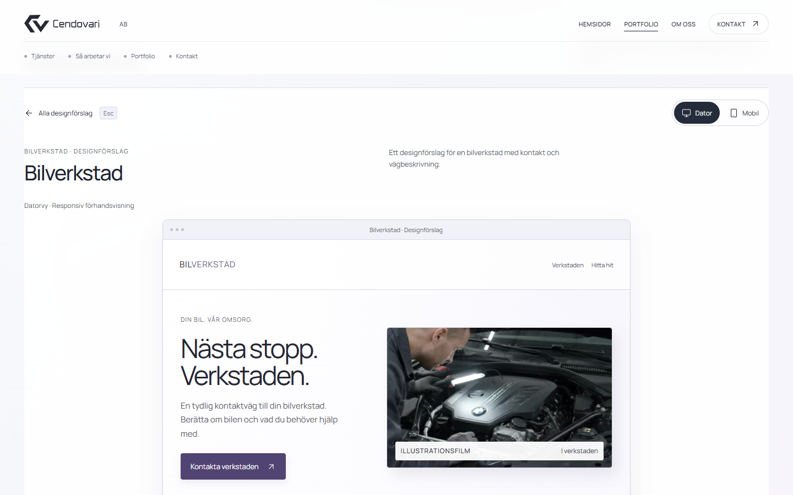
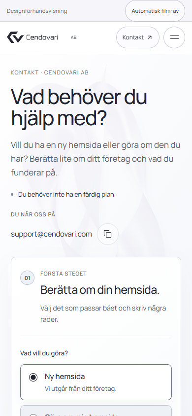
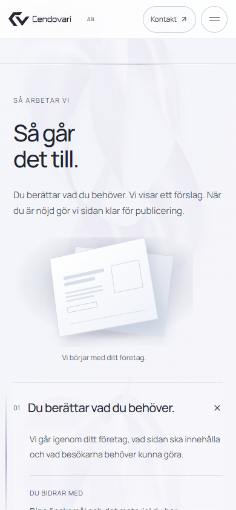
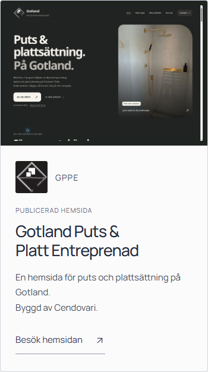
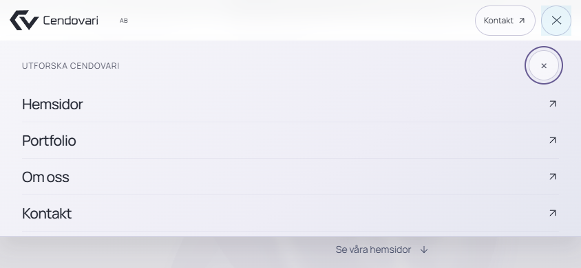

# Granskning av den godkända skulpturala bakgrunden

2026-10-13. Arbetet gäller endast `Cendovari/cendovari-webdesign-sida`.

**Publicerad och verifierad på den riktiga HTTPS-adressen den 13 oktober 2026.**

## Underlag och integration

Basen var demosidans rena `main`, commit `9ba066f6c26e5fe4e28e0d3bfdcad2ff2d3cf2b3`. Paketets referenskälla var byteidentisk med denna version och alla 22 kontrollsummor i manifestet matchade. Integrationen behåller därför tidigare rättelser av navigation, kontaktutkast och medier.

De godkända designändringarna är skulpturala former i silver, pärlemor och lila, mjuk musbelysning, ett ljust verkstadskoncept samt mörkare process- och kontakttext. GPPE och befintliga filmkort är bevarade.

Tre små tekniska korrigeringar kompletterar paketet. CSS använder korrekt syntax och samma `any-hover` och `any-pointer` som JavaScript, även för touch och mus tillsammans. Verkstadsplattans sista etikett ärver dess mörka textfärg. Ett `pointerleave` köar inga animeringsbilder när belysningen redan är osynlig. Layout och godkända material är oförändrade.

## Samma bild med lättare sidstart

Paketets `createArt` genererade bilden vid sidstart. Rasterisering och PNG-kodning tog cirka 426 ms i desktopbredd 1440 och 468 ms vid emulerad mobilbredd 390. PNG-kodningen stod för 338 respektive 312 ms; de sammanhängande uppgifterna under inläsningen var 510 respektive 525 ms. En simulering med fyra gånger långsammare CPU gav 733 ms för bildgenereringen och en sammanhängande uppgift på 1 077 ms. Simuleringen är ingen mätning på en fysisk telefon.

Paketet tillåter uttryckligen förberäkning av exakt samma konst. En oberoende återgenerering i Chrome gav samma PNG-byte som paketets faktiska körning. Samtliga avkodade RGBA-pixlar var också identiska:

- Bildmått: 896 × 1254 pixlar.
- PNG: 466 103 byte, SHA-256 `da3d70edf3f27d95306a89defe97b92e54a8a689e4fd93dcfecf3c5063d7bbcc`.
- RGBA: 4 494 336 byte, SHA-256 `7ff844d7ac567c22d70ef51a0e40747fab25373ae3ce2d247115db627d3a8242`.

Källan innehåller samma PNG inbäddad. Exportören flyttar den till `assets/images/cendovari-sculpture.png` utan omkodning. Originalalgoritmen finns i `scripts/sculpture-art.js`; det valfria `scripts/render-sculpture.cjs` återgenererar bilden offline med Chrome och Playwright och kräver uttrycklig utmatning. Vanlig export kräver fortfarande bara Python. PNG-kodning kan variera mellan webbläsarversioner, varför avkodade pixlar också jämförs.

Följning, geometri, pausvillkor och städning är bevarade, med den nämnda vakten för osynlig belysning. Bakgrunden behöver ingen löpande canvasmålning.

## Bakgrundens uppmätta beteende

Den publicerade bakgrunden passerade 50/50 kontroller. Ingen canvas skapades eller målades, inga layoutläsningar skedde inne i animationsticks och högst en bakgrundsframe var köad. Vid stillhet, touch, rörelsepaus, reducerad rörelse och simulerad dold flik återstod inga bakgrundsframes. Synlig belysning, mus med scroll, byteidentisk bild, begränsat tidssteg och automatisk städning när roten tas bort verifierades.

Medianen mellan aktiva callbacks var 13,3 ms och P95 13,5 ms i denna cirka 75 Hz-miljö. Under samtidiga QA-körningar förekom ett aktivt scroll-callbackgap på 199,9 ms; musprovet nådde som mest 41,1 ms. Resultatet är därför inte perfekt FPS eller en garanti för compositor-prestanda. Det mäter callbacks i den aktuella miljön, inte visade bildrutor på andra datorer eller telefoner.

Efter en avsiktligt injicerad blockering på 650 ms begränsades tidssteget till 0,05 s. Två andra uppgifter vid sidstart på 69 och 57 ms observerades i touchprovet. De tillskrivs inte canvasgenerering, som var borttagen.

Den isolerade uppföljningen gav också aktiva scrollgap: upp till 346,7ms utan skärmbilder och 320ms med en tidsloggad skärmbild. Skärmbildstagningen förklarade inte dessa gap. I en separat på/av-jämförelse följde en oberoende global rAF-klocka samma variation som bakgrunden: första kalla scrollpasset gav 306,5ms med bakgrund, efterföljande varmt pass 80ms utan. Omvänd testordning gav 373,5ms med bakgrunden helt borttagen och 53,3ms när bakgrunden återinfördes på varma vyer. Inga aktiva JavaScript-longtasks över 50ms observerades; geometri/BCR tog högst 0,1ms per anrop och trace-Paint/RasterTask högst cirka 1,6/2,1ms. Detta styrker inte ett återkommande fel i den nya bakgrunden eller en skärmbildsorsak; kallt scrollområde/testordning och Chromes globala frameleverans påverkar mätningen. Exakt underliggande browser-/GPU-orsak är inte fastställd. Variationen redovisas som begränsning, och resultaten är ingen fysisk FPS-garanti.

## Export, navigation och medier

Den slutliga statiska granskningen passerade 69/69 kontroller på källa `21fdf200…` och export `c585a749…`. Standardkommandot, äldre CLI, Python-API och upprepad byggning gav byteidentisk export. Nio negativa testfall avvisades före utmatnings- eller bildskrivningar: okända och felkodade medier, ändrade original, iframe, komplett HTML-dokument och beroende av ett förhandsvisnings-API.

Paketets 17 tidigare script är byteidentiska. Efter normalisering av rotens ID är 15 controllers exakt lika föregående huvudversion. Övriga godkända skillnader är workshoptext och kompakta medievärden. Navigations-, meny-, fokus-, Tillbaka-, Escape-, kontakt- och filmkontrakt är bevarade.

Tre fullängdsfilmer och sex befintliga bilder är byteidentiska med paketet och föregående `main`, inklusive toppfilmen `9bf277fb…` och fullpostern `0dbd5567…`. Kompaktpostern `b413…` mappas till den verifierade fullpostern utan att skriva över den. Exportskal, CSP, svenska, ikoner, `noindex,nofollow` och bygggränssnitt är bevarade. Bildverktygen saknar privata profilsökvägar och API-uppgifter.

Offentlig Chrome-granskning omfattar 320 × 844, 390 × 844, 768 × 1024, 1440 × 900, 844 × 390 och reducerad rörelse vid 390. Funktionella navigation-, meny-, projekt-, kontakt-, fokus-, scroll- och overflowkontroller passerade. Fyra tidsserier verifierade 140 ms innehållstoning utan varumärkesoverlay, omladdning eller headerförskjutning. Källförhandsvisningen hade tidigare passerat 16/16 lokala kontroller vid 1440 och 390.

Filmerna testades offentligt i åtta prov med två hela varv vid 390 och 1440: toppfilm, startsidans verkstadskort och båda projektcontrollers. De funktionella filmkontrollerna passerade 147/147. Totalt avkodades 4 246 frames och 4 245 `requestVideoFrameCallback`-anrop observerades; räknarna hålls isär. Inga dropped frames, stalls, mediaerror-events eller återställningar av src, load eller currentTime observerades vid vanlig scroll och paus. Kontinuitet, rörelseval och nekad autoplay verifierades.

## Råavbrott och publiceringskvitto

Yttestmatrisens råresultat var 187/191 och filmtesternas 149/151. Fyra respektive två underkända assertions gällde strikta krav på noll avbrutna nätbegäranden. Yttesterna observerade sex CDP-begäranden med `canceled:true`, typen Media och `net::ERR_ABORTED`: fem Bilverkstad vid sektions- eller touchscroll och en Plattsättning när projektvyn stängdes. Filmtesterna observerade två showreel-avbrott i den avsiktliga stressfasen med gammal controllerägare och återinstallation, efter normala tvåvarvsprov.

Avbrotten finns kvar i rådata och rapporteras inte som noll resursavbrott. Inga andra funktionella fel, JS-fel, nätfel utan canceled-markering, HTTP-fel eller backendanrop observerades. Originalfilerna gav 200 med rätt hash och Range gav 206; normal uppspelning och återkomst verifierades. Ingen appändring gjordes för att dölja nätassertions.

Publicerat innehåll är [e0726e5](https://github.com/Cendovari/cendovari-webdesign-sida/commit/e0726e5b73f1431372d9d12d73a083ee8a90423d), en vanlig childcommit från `9ba066f` och fast-forward via `codex/smooth-art`. [Pages-bygge 38361056205](https://github.com/Cendovari/cendovari-webdesign-sida/actions/runs/38361056205) slutfördes med success. [HTTPS-förhandsvisningen](https://cendovari.github.io/cendovari-webdesign-sida/) gav 200 och exakt index-SHA `c585a7497e42f33a4ec5e01da92e796e4ebc50bbd590f40afb4249e969758d92`. Alla 28 kontrollerade filer matchade, inklusive sju rena skärmbilder, fulla medier, GPPE och skulpturen. Tre byte-rangebegäranden gav 206 med rätt bytes. En senare dokumentationscommit sparar kvittot utan runtime- eller medieändringar; bygget och samma HTTPS-filer kontrolleras efteråt.

## Begränsningar och omfattning

Chrome 154.0.8037.98 på Windows användes. Skärmstorlekar och touch är emulering; hybridläge, dold flik och nekad autoplay provas med uttryckliga simuleringar eller injektioner. Ingen fysisk iPhone, Android, Safari eller hybridenhet verifierades. Ingen FPS-garanti lämnas för andra miljöer.

Formuläret ger endast ett lokalt utkast, utan backend eller mejlutskick. Inga nya kundpåståenden har lagts till. Alla skrivningar gäller demorepot. Cendovari-Website, Modbus Buddy, WordPress, cendovari.com, gppe.se, hosting och DNS är orörda.

## Skärmbilder

